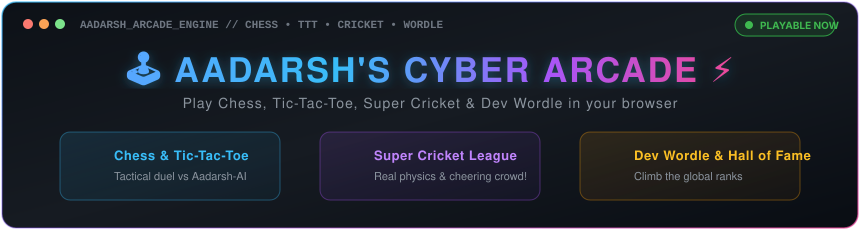
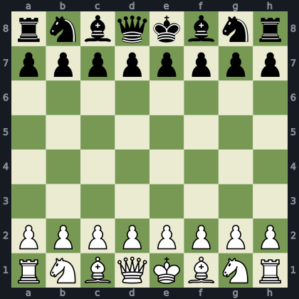

<!-- ARCADE:START -->
<p align="center">
  
</p>

<p align="center">
  <a href="#-game-1-connect-four-vs-aadarsh-ai"><b>🟡 Connect Four</b></a> &nbsp;•&nbsp;
  <a href="#-game-2-tic-tac-toe-vs-aadarsh-ai"><b>❌ Tic-Tac-Toe</b></a> &nbsp;•&nbsp;
  <a href="#-game-3-community-chess-vs-aadarsh-ai"><b>♟️ Chess</b></a> &nbsp;•&nbsp;
  <a href="#-game-4-developer-wordle"><b>🟩 Dev Wordle</b></a> &nbsp;•&nbsp;
  <a href="#-hall-of-fame--community-leaderboard"><b>🏆 Hall of Fame</b></a>
</p>

<div align="center">

| 1️⃣ Choose Your Move | 2️⃣ Click 'Submit new issue' | 3️⃣ Watch the Board Update! |
| :---: | :---: | :---: |
| Click any number or move button below | A pre-filled issue opens with your move | GitHub Actions plays the AI's turn in ~10s! 🚀 |

</div>

---
### 🟡 Game 1: Connect Four vs Aadarsh-AI
> **Goal:** Drop tokens to align 4 in a row (horizontal, vertical, or diagonal). You are 🟡, Aadarsh-AI is 🔵!

<div align="center">

| [ 1️⃣ ](https://github.com/sudo-aadarsh/sudo-aadarsh/issues/new?title=arcade%3Ac4%3Adrop%3A0&body=Click+%27Submit+new+issue%27+to+drop+your+%F0%9F%9F%A1+token+in+Column+1%21%0A%0A%2A%28Automated+turn+for+%40sudo-aadarsh%27s+arcade%29%2A) | [ 2️⃣ ](https://github.com/sudo-aadarsh/sudo-aadarsh/issues/new?title=arcade%3Ac4%3Adrop%3A1&body=Click+%27Submit+new+issue%27+to+drop+your+%F0%9F%9F%A1+token+in+Column+2%21%0A%0A%2A%28Automated+turn+for+%40sudo-aadarsh%27s+arcade%29%2A) | [ 3️⃣ ](https://github.com/sudo-aadarsh/sudo-aadarsh/issues/new?title=arcade%3Ac4%3Adrop%3A2&body=Click+%27Submit+new+issue%27+to+drop+your+%F0%9F%9F%A1+token+in+Column+3%21%0A%0A%2A%28Automated+turn+for+%40sudo-aadarsh%27s+arcade%29%2A) | [ 4️⃣ ](https://github.com/sudo-aadarsh/sudo-aadarsh/issues/new?title=arcade%3Ac4%3Adrop%3A3&body=Click+%27Submit+new+issue%27+to+drop+your+%F0%9F%9F%A1+token+in+Column+4%21%0A%0A%2A%28Automated+turn+for+%40sudo-aadarsh%27s+arcade%29%2A) | [ 5️⃣ ](https://github.com/sudo-aadarsh/sudo-aadarsh/issues/new?title=arcade%3Ac4%3Adrop%3A4&body=Click+%27Submit+new+issue%27+to+drop+your+%F0%9F%9F%A1+token+in+Column+5%21%0A%0A%2A%28Automated+turn+for+%40sudo-aadarsh%27s+arcade%29%2A) | [ 6️⃣ ](https://github.com/sudo-aadarsh/sudo-aadarsh/issues/new?title=arcade%3Ac4%3Adrop%3A5&body=Click+%27Submit+new+issue%27+to+drop+your+%F0%9F%9F%A1+token+in+Column+6%21%0A%0A%2A%28Automated+turn+for+%40sudo-aadarsh%27s+arcade%29%2A) | [ 7️⃣ ](https://github.com/sudo-aadarsh/sudo-aadarsh/issues/new?title=arcade%3Ac4%3Adrop%3A6&body=Click+%27Submit+new+issue%27+to+drop+your+%F0%9F%9F%A1+token+in+Column+7%21%0A%0A%2A%28Automated+turn+for+%40sudo-aadarsh%27s+arcade%29%2A) |
| :---: | :---: | :---: | :---: | :---: | :---: | :---: |
| ⚪ | ⚪ | ⚪ | ⚪ | ⚪ | ⚪ | ⚪ |
| ⚪ | ⚪ | ⚪ | ⚪ | ⚪ | ⚪ | ⚪ |
| ⚪ | ⚪ | ⚪ | ⚪ | ⚪ | ⚪ | ⚪ |
| ⚪ | ⚪ | ⚪ | ⚪ | ⚪ | ⚪ | ⚪ |
| ⚪ | ⚪ | ⚪ | ⚪ | ⚪ | ⚪ | ⚪ |
| ⚪ | ⚪ | ⚪ | ⚪ | ⚪ | ⚪ | ⚪ |

</div>

**Turn:** 🟡 **Visitor's Turn** vs 🔵 **Aadarsh-AI** &nbsp;|&nbsp; *Click any number button (`1️⃣` to `7️⃣`) above to drop!*
**Last Play:** `None`

[ 🔄 Start New Connect Four Match ](https://github.com/sudo-aadarsh/sudo-aadarsh/issues/new?title=arcade%3Ac4%3Anew&body=Click+%27Submit+new+issue%27+to+start+a+fresh+Connect+Four+game%21)

---
### ❌ Game 2: Tic-Tac-Toe vs Aadarsh-AI
> **Goal:** Get 3 in a row! You are ❌, Aadarsh-AI is ⭕. Click any empty `[ ⬜ ]` to place your mark.

<div align="center">

| 1️⃣ | 2️⃣ | 3️⃣ |
| :---: | :---: | :---: |
| [ ⬜ ](https://github.com/sudo-aadarsh/sudo-aadarsh/issues/new?title=arcade%3Attt%3Amove%3A0%2C0&body=Click+%27Submit+new+issue%27+to+play+%E2%9D%8C+at+Row+1%2C+Column+1%21%0A%0A%2A%28Automated+move%29%2A) | [ ⬜ ](https://github.com/sudo-aadarsh/sudo-aadarsh/issues/new?title=arcade%3Attt%3Amove%3A0%2C1&body=Click+%27Submit+new+issue%27+to+play+%E2%9D%8C+at+Row+1%2C+Column+2%21%0A%0A%2A%28Automated+move%29%2A) | [ ⬜ ](https://github.com/sudo-aadarsh/sudo-aadarsh/issues/new?title=arcade%3Attt%3Amove%3A0%2C2&body=Click+%27Submit+new+issue%27+to+play+%E2%9D%8C+at+Row+1%2C+Column+3%21%0A%0A%2A%28Automated+move%29%2A) |
| [ ⬜ ](https://github.com/sudo-aadarsh/sudo-aadarsh/issues/new?title=arcade%3Attt%3Amove%3A1%2C0&body=Click+%27Submit+new+issue%27+to+play+%E2%9D%8C+at+Row+2%2C+Column+1%21%0A%0A%2A%28Automated+move%29%2A) | [ ⬜ ](https://github.com/sudo-aadarsh/sudo-aadarsh/issues/new?title=arcade%3Attt%3Amove%3A1%2C1&body=Click+%27Submit+new+issue%27+to+play+%E2%9D%8C+at+Row+2%2C+Column+2%21%0A%0A%2A%28Automated+move%29%2A) | [ ⬜ ](https://github.com/sudo-aadarsh/sudo-aadarsh/issues/new?title=arcade%3Attt%3Amove%3A1%2C2&body=Click+%27Submit+new+issue%27+to+play+%E2%9D%8C+at+Row+2%2C+Column+3%21%0A%0A%2A%28Automated+move%29%2A) |
| [ ⬜ ](https://github.com/sudo-aadarsh/sudo-aadarsh/issues/new?title=arcade%3Attt%3Amove%3A2%2C0&body=Click+%27Submit+new+issue%27+to+play+%E2%9D%8C+at+Row+3%2C+Column+1%21%0A%0A%2A%28Automated+move%29%2A) | [ ⬜ ](https://github.com/sudo-aadarsh/sudo-aadarsh/issues/new?title=arcade%3Attt%3Amove%3A2%2C1&body=Click+%27Submit+new+issue%27+to+play+%E2%9D%8C+at+Row+3%2C+Column+2%21%0A%0A%2A%28Automated+move%29%2A) | [ ⬜ ](https://github.com/sudo-aadarsh/sudo-aadarsh/issues/new?title=arcade%3Attt%3Amove%3A2%2C2&body=Click+%27Submit+new+issue%27+to+play+%E2%9D%8C+at+Row+3%2C+Column+3%21%0A%0A%2A%28Automated+move%29%2A) |

</div>

**Turn:** ❌ **Visitor's Turn** vs ⭕ **Aadarsh-AI** &nbsp;|&nbsp; *Click any `[ ⬜ ]` square above!*
**Last Play:** `Waiting for challenger's first move!`

[ 🔄 Start New Tic-Tac-Toe Match ](https://github.com/sudo-aadarsh/sudo-aadarsh/issues/new?title=arcade%3Attt%3Anew&body=Click+%27Submit+new+issue%27+to+start+a+fresh+Tic-Tac-Toe+match%21)

---
### ♟️ Game 3: Community Chess vs Aadarsh-AI
> **Goal:** Outsmart Aadarsh-AI! You play White ⚪, Aadarsh-AI plays Black ⚫. Click any move below to play!

<div align="center">

  

**⚡ Quick Suggested Moves for White:**

| Move Option 1 | Move Option 2 | Move Option 3 | Move Option 4 |
| :---: | :---: | :---: | :---: |
| [ `Nh3` ](https://github.com/sudo-aadarsh/sudo-aadarsh/issues/new?title=arcade%3Achess%3Amove%3Ag1h3&body=Click+%27Submit+new+issue%27+to+play+%60Nh3%60+%28g1h3%29%21%0A%0A%2A%28Automated+chess+move%29%2A) | [ `Nf3` ](https://github.com/sudo-aadarsh/sudo-aadarsh/issues/new?title=arcade%3Achess%3Amove%3Ag1f3&body=Click+%27Submit+new+issue%27+to+play+%60Nf3%60+%28g1f3%29%21%0A%0A%2A%28Automated+chess+move%29%2A) | [ `Nc3` ](https://github.com/sudo-aadarsh/sudo-aadarsh/issues/new?title=arcade%3Achess%3Amove%3Ab1c3&body=Click+%27Submit+new+issue%27+to+play+%60Nc3%60+%28b1c3%29%21%0A%0A%2A%28Automated+chess+move%29%2A) | [ `Na3` ](https://github.com/sudo-aadarsh/sudo-aadarsh/issues/new?title=arcade%3Achess%3Amove%3Ab1a3&body=Click+%27Submit+new+issue%27+to+play+%60Na3%60+%28b1a3%29%21%0A%0A%2A%28Automated+chess+move%29%2A) |
| [ `h3` ](https://github.com/sudo-aadarsh/sudo-aadarsh/issues/new?title=arcade%3Achess%3Amove%3Ah2h3&body=Click+%27Submit+new+issue%27+to+play+%60h3%60+%28h2h3%29%21%0A%0A%2A%28Automated+chess+move%29%2A) | [ `g3` ](https://github.com/sudo-aadarsh/sudo-aadarsh/issues/new?title=arcade%3Achess%3Amove%3Ag2g3&body=Click+%27Submit+new+issue%27+to+play+%60g3%60+%28g2g3%29%21%0A%0A%2A%28Automated+chess+move%29%2A) | [ `f3` ](https://github.com/sudo-aadarsh/sudo-aadarsh/issues/new?title=arcade%3Achess%3Amove%3Af2f3&body=Click+%27Submit+new+issue%27+to+play+%60f3%60+%28f2f3%29%21%0A%0A%2A%28Automated+chess+move%29%2A) | [ `e3` ](https://github.com/sudo-aadarsh/sudo-aadarsh/issues/new?title=arcade%3Achess%3Amove%3Ae2e3&body=Click+%27Submit+new+issue%27+to+play+%60e3%60+%28e2e3%29%21%0A%0A%2A%28Automated+chess+move%29%2A) |

[ ✍️ Submit Any Custom Move ](https://github.com/sudo-aadarsh/sudo-aadarsh/issues/new?title=arcade%3Achess%3Amove%3Ae4&body=Replace+%27e4%27+in+the+title+above+with+your+desired+SAN+move+%28e.g.+Nf3%2C+Bb5%2C+O-O%2C+d4%29+and+submit+this+issue%21) &nbsp;|&nbsp; [ 🔄 Start New Chess Match ](https://github.com/sudo-aadarsh/sudo-aadarsh/issues/new?title=arcade%3Achess%3Anew&body=Click+%27Submit+new+issue%27+to+reset+the+chessboard+to+start+a+new+game%21)

</div>

**Last Plays:** `Game just began (1. e4...)`

---
### 🟩 Game 4: Developer Wordle
> **Goal:** Guess the secret 5-letter software engineering term in 6 tries! Feedback: 🟩 Correct spot, 🟨 Wrong spot, ⬛ Not in word.

<div align="center">

| 1️⃣ | 2️⃣ | 3️⃣ | 4️⃣ | 5️⃣ | Challenger |
| :---: | :---: | :---: | :---: | :---: | :--- |
| ⬜ ` ` | ⬜ ` ` | ⬜ ` ` | ⬜ ` ` | ⬜ ` ` | *Empty* |
| ⬜ ` ` | ⬜ ` ` | ⬜ ` ` | ⬜ ` ` | ⬜ ` ` | *Empty* |
| ⬜ ` ` | ⬜ ` ` | ⬜ ` ` | ⬜ ` ` | ⬜ ` ` | *Empty* |
| ⬜ ` ` | ⬜ ` ` | ⬜ ` ` | ⬜ ` ` | ⬜ ` ` | *Empty* |
| ⬜ ` ` | ⬜ ` ` | ⬜ ` ` | ⬜ ` ` | ⬜ ` ` | *Empty* |
| ⬜ ` ` | ⬜ ` ` | ⬜ ` ` | ⬜ ` ` | ⬜ ` ` | *Empty* |

</div>

<details>
<summary><b>🔤 Alphabet Key Status</b> (Click to inspect available letters)</summary>

<p align="center">

`A`⚪ &nbsp; `B`⚪ &nbsp; `C`⚪ &nbsp; `D`⚪ &nbsp; `E`⚪ &nbsp; `F`⚪ &nbsp; `G`⚪ &nbsp; `H`⚪ &nbsp; `I`⚪ &nbsp; `J`⚪ &nbsp; `K`⚪ &nbsp; `L`⚪ &nbsp; `M`⚪<br/><br/>`N`⚪ &nbsp; `O`⚪ &nbsp; `P`⚪ &nbsp; `Q`⚪ &nbsp; `R`⚪ &nbsp; `S`⚪ &nbsp; `T`⚪ &nbsp; `U`⚪ &nbsp; `V`⚪ &nbsp; `W`⚪ &nbsp; `X`⚪ &nbsp; `Y`⚪ &nbsp; `Z`⚪

</p>

</details>

<div align="center">

[ 🎯 Click Here to Submit a 5-Letter Word Guess ](https://github.com/sudo-aadarsh/sudo-aadarsh/issues/new?title=arcade%3Awordle%3Aguess%3AREACT&body=Replace+%27REACT%27+in+the+issue+title+above+with+your+5-letter+tech+guess+%28e.g.+LINUX%2C+REDIS%2C+ASYNC%2C+STACK%2C+CLOUD%29+and+submit%21)

💡 **Suggested Starters:** [`REACT`](https://github.com/sudo-aadarsh/sudo-aadarsh/issues/new?title=arcade%3Awordle%3Aguess%3AREACT&body=Click+%27Submit+new+issue%27+to+guess+%60REACT%60%21) &nbsp;|&nbsp; [`LINUX`](https://github.com/sudo-aadarsh/sudo-aadarsh/issues/new?title=arcade%3Awordle%3Aguess%3ALINUX&body=Click+%27Submit+new+issue%27+to+guess+%60LINUX%60%21) &nbsp;|&nbsp; [`ASYNC`](https://github.com/sudo-aadarsh/sudo-aadarsh/issues/new?title=arcade%3Awordle%3Aguess%3AASYNC&body=Click+%27Submit+new+issue%27+to+guess+%60ASYNC%60%21)

**Attempts Remaining:** ⏳ **6 / 6**

</div>

[ 🔄 Start New Wordle Puzzle ](https://github.com/sudo-aadarsh/sudo-aadarsh/issues/new?title=arcade%3Awordle%3Anew&body=Click+%27Submit+new+issue%27+to+generate+a+fresh+Wordle+puzzle%21)

---
### 🏆 Hall of Fame & Community Leaderboard

> **Arcade Stats:** 👥 **1** Active Players &nbsp;|&nbsp; 🕹️ **7** Total Turns Played &nbsp;|&nbsp; 👑 Current Champion: **[@sudo-aadarsh](https://github.com/sudo-aadarsh)**

| Rank | Challenger | Total Score | Games Won | Current Streak | Badges |
| :---: | :--- | :---: | :---: | :---: | :--- |
| 🥇 1 | [@sudo-aadarsh](https://github.com/sudo-aadarsh) | **120 pts** | 7 | 🔥 3 | 👑 Grandmaster, ⚡ Wordle Wizard, 🎯 Tactician |

<details>
<summary><b>📜 Scoring Rules & How to Earn Points</b></summary>

- 🎯 **Connect Four:** Win = **+30 pts** | Move = **+2 pts** | Draw = **+10 pts**
- ❌ **Tic-Tac-Toe:** Win = **+20 pts** | Move = **+1 pt** | Draw = **+5 pts**
- ♟️ **Chess:** Win = **+50 pts** | Valid Move = **+2 pts** | Draw = **+15 pts**
- 🟩 **Developer Wordle:** Solved = **+25 pts** (+Bonus for fewer tries) | Valid Guess = **+3 pts**
- 🏅 **Streaks:** Win multiple games in a row to earn the **🔥 On Fire** badge!
</details>

<!-- ARCADE:END -->

---

## 🐍 Contribution Snake


```diff
+ STATUS: ONLINE
+ USER: Aadarsh
+ ROLE: Developer
+ LEVEL: Grinding 🚀
