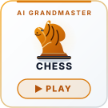
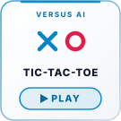

  

  <picture>
    <source media="(prefers-color-scheme: dark)" srcset="assets/arcade-header-dark.svg">
    <source media="(prefers-color-scheme: light)" srcset="assets/arcade-header-light.svg">
    
  </picture>

  <a href="https://sudo-aadarsh.github.io/sudo-aadarsh/#chess" title="Play Chess vs Grandmaster AI"><picture><source media="(prefers-color-scheme: dark)" srcset="assets/tiles/chess-dark.svg"><source media="(prefers-color-scheme: light)" srcset="assets/tiles/chess-light.svg"></picture></a>
  &nbsp;
  <a href="https://sudo-aadarsh.github.io/sudo-aadarsh/#ttt" title="Play Tic-Tac-Toe vs AI"><picture><source media="(prefers-color-scheme: dark)" srcset="assets/tiles/ttt-dark.svg"><source media="(prefers-color-scheme: light)" srcset="assets/tiles/ttt-light.svg"></picture></a>
  &nbsp;
  <a href="https://sudo-aadarsh.github.io/sudo-aadarsh/#cricket" title="Play Super Cricket (Bat & Bowl)"><picture><source media="(prefers-color-scheme: dark)" srcset="assets/tiles/cricket-dark.svg"><source media="(prefers-color-scheme: light)" srcset="assets/tiles/cricket-light.svg"></picture></a>
  &nbsp;
  <a href="https://sudo-aadarsh.github.io/sudo-aadarsh/#apex" title="Play Apex Velocity 3D Racing"><picture><source media="(prefers-color-scheme: dark)" srcset="assets/tiles/apex-dark.svg"><source media="(prefers-color-scheme: light)" srcset="assets/tiles/apex-light.svg"></picture></a>
  &nbsp;
  <a href="https://sudo-aadarsh.github.io/sudo-aadarsh/#leaderboard" title="View Arcade Leaderboard"><picture><source media="(prefers-color-scheme: dark)" srcset="assets/tiles/leaderboard-dark.svg"><source media="(prefers-color-scheme: light)" srcset="assets/tiles/leaderboard-light.svg"></picture></a>

 

  <picture>
    <source media="(prefers-color-scheme: dark)" srcset="assets/aadarsh-ascii-art-dark.gif">
    <source media="(prefers-color-scheme: light)" srcset="assets/aadarsh-ascii-art-light.gif">
    
  </picture>

 

---

  <picture>
    <source media="(prefers-color-scheme: dark)" srcset="assets/pacman-dark.svg">
    <source media="(prefers-color-scheme: light)" srcset="assets/pacman-light.svg">
    
  </picture>

